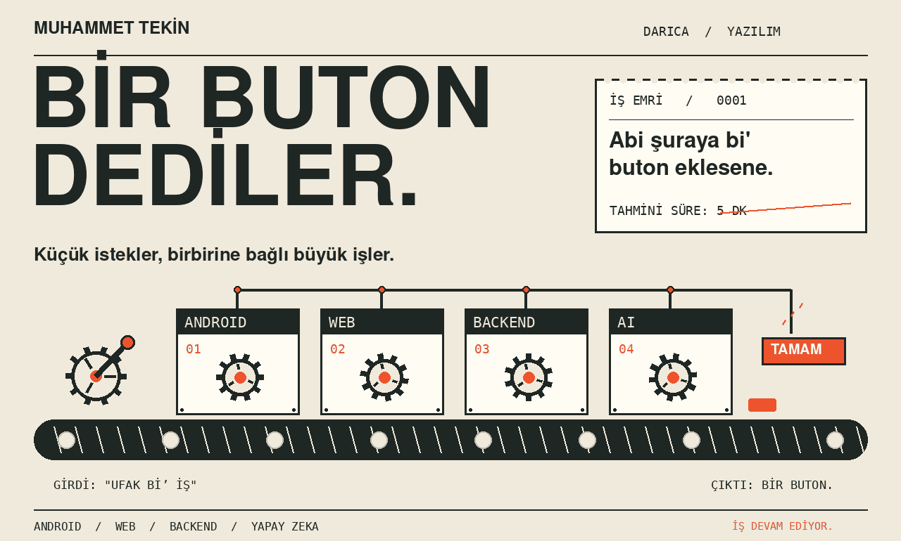
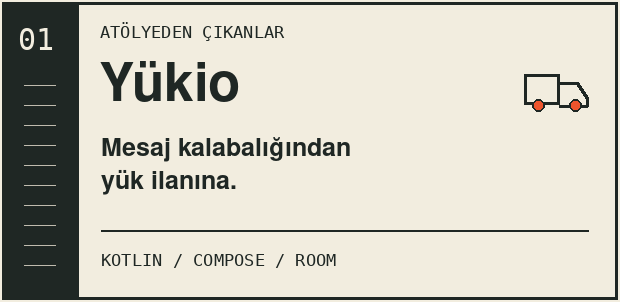
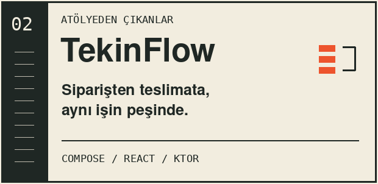
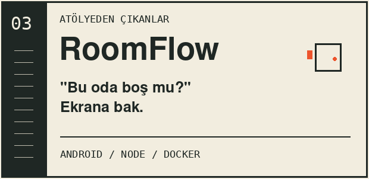
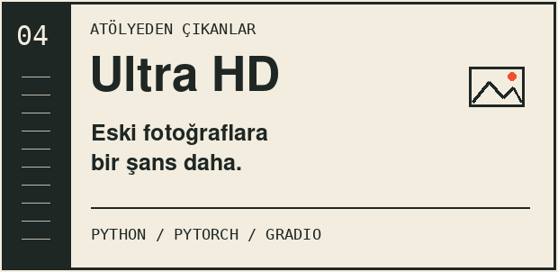
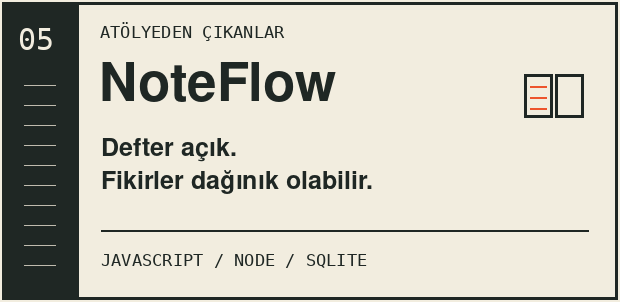
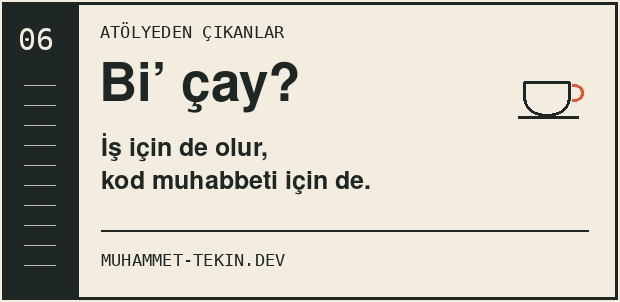

<picture>
  <source media="(prefers-reduced-motion: reduce)" srcset="assets/workshop-still.png">
  
</picture>

**Muhammet ben.** Android, web ve backend tarafında çalışıyorum. Arada eski fotoğraflarla, arada dijital defterlerle uğraşıyorum. Darıca’dayım; yaptığım işler aşağıda.

[Kişisel site](https://muhammet-tekin.dev) &nbsp; / &nbsp; [LinkedIn](https://www.linkedin.com/in/muhammet-tekin-41kocaeli/) &nbsp; / &nbsp; [E-posta](mailto:tekin.muhammet@proton.me)

## Tezgahtaki işler

**Yükio** [APK indir](https://github.com/Tekin4124/yukio-android-demo/releases/latest/download/Yukio.apk) &nbsp; · &nbsp; **TekinFlow** [Web demo](https://tekinflow.muhammet-tekin.dev) / [APK indir](https://github.com/Tekin4124/tekinflow/releases/latest/download/TekinFlow.apk)

**RoomFlow** [Canlı takvim](https://roomflow.muhammet-tekin.dev) / [Panel](https://roomflow.muhammet-tekin.dev/admin) / [APK indir](https://github.com/Tekin4124/roomflow/releases/latest/download/RoomFlow.apk) &nbsp; · &nbsp; **Ultra HD** [GPU kurulumu](https://github.com/Tekin4124/AI-UltraHD-Restoration#readme)

**NoteFlow** [Defteri aç](https://defter.muhammet-tekin.dev) &nbsp; · &nbsp; **İletişim** [tekin.muhammet@proton.me](mailto:tekin.muhammet@proton.me)

---

*Kotlin · Jetpack Compose · React · TypeScript · Node.js · Ktor · PostgreSQL · Python · Docker · Linux*

Canlı demolar örnek verilerle çalışır. Özel sistemlere veya gerçek operasyon verilerine bağlanmaz. Kapaktaki iş emri ise temsili; beş dakikayı taahhüt etmiyorum.
