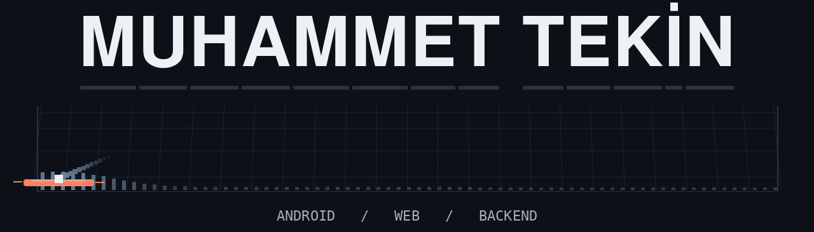
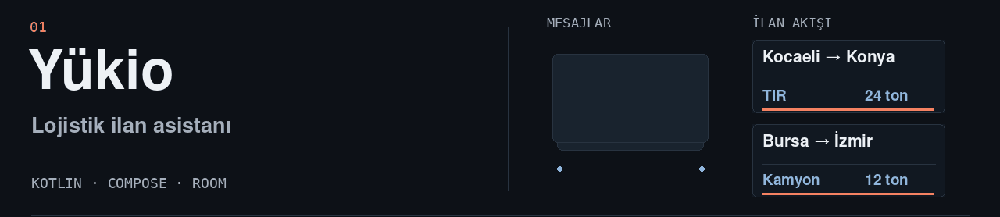
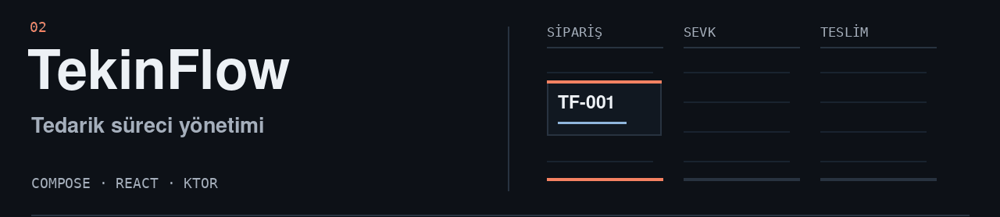
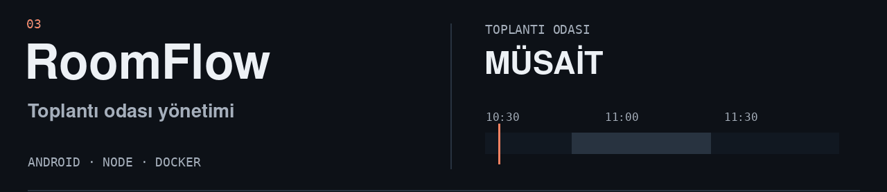
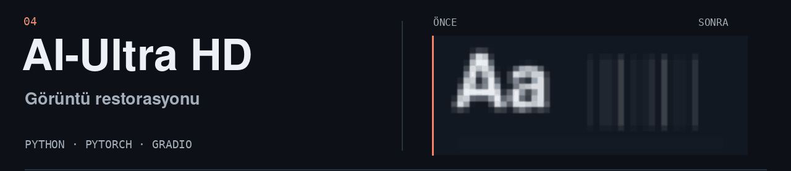
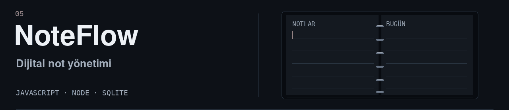

<picture>
  <source media="(prefers-reduced-motion: reduce)" srcset="assets/profile-arcade-header-v2-still.png">
  
</picture>

<a href="https://github.com/Tekin4124/yukio-android-demo">
  <picture>
    <source media="(prefers-reduced-motion: reduce) and (max-width: 700px)" srcset="assets/motion-yukio-v5-mobile-still.png">
    <source media="(prefers-reduced-motion: reduce)" srcset="assets/motion-yukio-v5-still.png">
    <source media="(max-width: 700px)" srcset="assets/motion-yukio-v5-mobile.gif">
    
  </picture>
</a>

<a href="https://github.com/Tekin4124/tekinflow">
  <picture>
    <source media="(prefers-reduced-motion: reduce) and (max-width: 700px)" srcset="assets/motion-tekinflow-v2-mobile-still.png">
    <source media="(prefers-reduced-motion: reduce)" srcset="assets/motion-tekinflow-v2-still.png">
    <source media="(max-width: 700px)" srcset="assets/motion-tekinflow-v2-mobile.gif">
    
  </picture>
</a>

<a href="https://github.com/Tekin4124/roomflow">
  <picture>
    <source media="(prefers-reduced-motion: reduce) and (max-width: 700px)" srcset="assets/motion-roomflow-v2-mobile-still.png">
    <source media="(prefers-reduced-motion: reduce)" srcset="assets/motion-roomflow-v2-still.png">
    <source media="(max-width: 700px)" srcset="assets/motion-roomflow-v2-mobile.gif">
    
  </picture>
</a>

<a href="https://github.com/Tekin4124/AI-UltraHD-Restoration">
  <picture>
    <source media="(prefers-reduced-motion: reduce) and (max-width: 700px)" srcset="assets/motion-ultrahd-v3-mobile-still.png">
    <source media="(prefers-reduced-motion: reduce)" srcset="assets/motion-ultrahd-v3-still.png">
    <source media="(max-width: 700px)" srcset="assets/motion-ultrahd-v3-mobile.gif">
    
  </picture>
</a>

<a href="https://github.com/Tekin4124/noteflow">
  <picture>
    <source media="(prefers-reduced-motion: reduce) and (max-width: 700px)" srcset="assets/motion-noteflow-v6-mobile-still.png">
    <source media="(prefers-reduced-motion: reduce)" srcset="assets/motion-noteflow-v6-still.png">
    <source media="(max-width: 700px)" srcset="assets/motion-noteflow-v6-mobile.gif">
    
  </picture>
</a>
