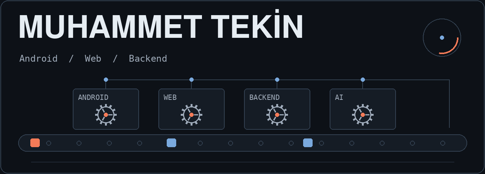
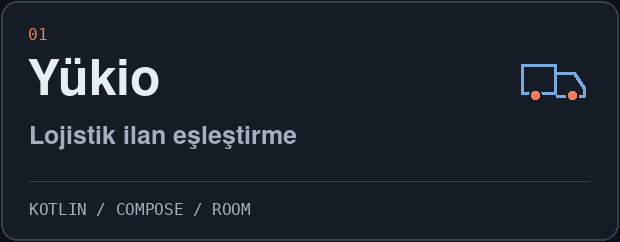
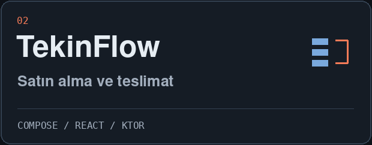
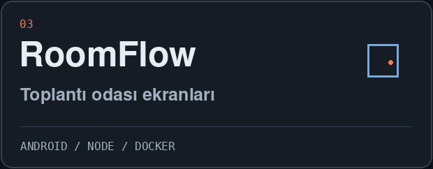
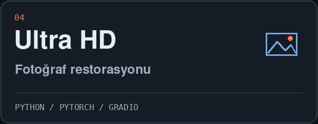
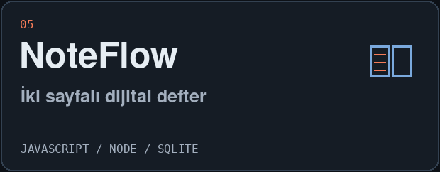
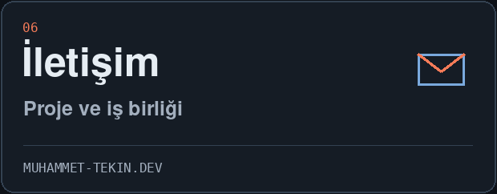

<picture>
  <source media="(prefers-reduced-motion: reduce)" srcset="assets/profile-dark-static.png">
  
</picture>

[Site](https://muhammet-tekin.dev) &nbsp; / &nbsp; [LinkedIn](https://www.linkedin.com/in/muhammet-tekin-41kocaeli/) &nbsp; / &nbsp; [E-posta](mailto:tekin.muhammet@proton.me)

